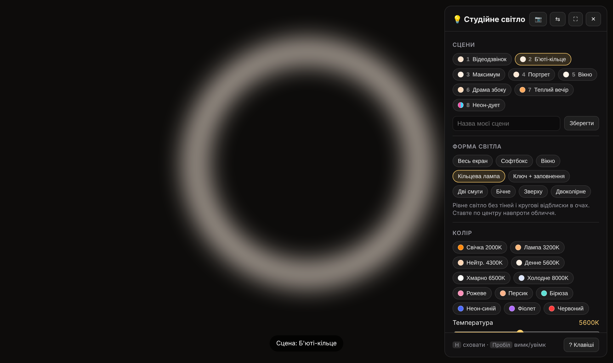

# Studio Light

Turn any screen into an adjustable face light for video calls, streams and selfies: colour temperature, tint, softness, shape and position, all in one HTML file with no install.

**Live demo:** [danyilshkodiuk.github.io/studio-light](https://danyilshkodiuk.github.io/studio-light/)

## Features

- **9 light shapes:** full screen, softbox, window, ring light, key + fill, two strips, side light, top light and two-colour
- **Colour control:** temperature from 2000 K to 10000 K, green ↔ magenta tint, quick presets, or any custom RGB colour
- **Light character:** brightness, fill and background level, softness, size, proportions and corner rounding
- **Scenes:** 8 built-in looks (video call, beauty ring, portrait, warm evening, neon duo…), plus your own scenes saved in the browser with JSON export and import
- **Positioning:** sliders or drag the light directly on screen, mirror mode
- **Camera preview** to check the result live, without leaving the page
- **Undo / redo** and keyboard shortcuts: `H` panel, `F` full screen, `Space` on/off, arrows to move, `[` `]` to resize, `1`–`9` for scenes

## Run locally

Download [`studio-light.html`](studio-light.html) and open it in any modern browser. No build step and no dependencies.

## Tech

Vanilla HTML, CSS and JavaScript in a single file. Settings and scenes are stored in `localStorage`; the camera preview uses `getUserMedia`.

---

## Українською

Перетворює екран на налаштовуване студійне світло для обличчя: температура кольору, відтінок, м'якість, форма, положення, сцени.

**Демо:** [danyilshkodiuk.github.io/studio-light](https://danyilshkodiuk.github.io/studio-light/)

- Форми світла: весь екран, софтбокс, вікно, кільцева лампа, ключ + заповнення, дві смуги, бічне, зверху, двоколірне
- Сцени зберігаються в браузері, є експорт та імпорт у JSON
- Гарячі клавіші: H, F, пробіл, стрілки, [ ], 1–9

Щоб запустити локально, відкрийте `studio-light.html` у будь-якому браузері. Нічого встановлювати не треба.
